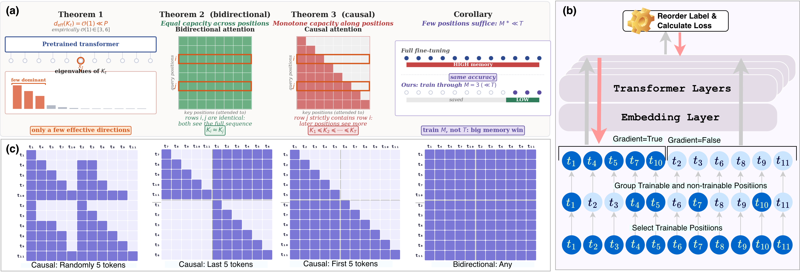

<div align="center">

# Where You Backpropagate Matters: Token Hypothesis for Memory-Efficient Fine-Tuning

**Md Kowsher**<sup>1,2</sup> · **Chen Chen**<sup>2</sup>

<sup>1</sup>Meta · <sup>2</sup>University of Central Florida

**NeurIPS 2026**

[📄 Paper](#) · [🌐 Project Page](#) · [📝 arXiv](#) · [📚 BibTeX](#citation)

</div>

---

<p align="center">
  
</p>

**TL;DR.** Fine-tuning stores activations at *every* token position, and that memory grows linearly with sequence length. Using a Neural Tangent Kernel analysis, we show that each position is a low-dimensional capacity bottleneck. As a result, you only need to **backpropagate through a small subset of positions** while keeping the **full forward pass**:

- **Causal models** (LLaMA, Qwen-VL, LLaVA): train the **last M** positions.
- **Bidirectional models** (RoBERTa, ViT): **any M** positions work.

The same wrapper works for **full fine-tuning, LoRA, LoRA-FA, DoRA, QLoRA and Propulsion**. After training, the wrapper is removed, so inference is unchanged.

---

## Contents

- [How it works](#how-it-works)
- [Installation](#installation)
- [Quick start: use it in your own training code](#quick-start-use-it-in-your-own-training-code)
- [Repository structure](#repository-structure)
- [Reproducing the paper](#reproducing-the-paper)
- [Choosing M](#choosing-m)
- [Notes and limitations](#notes-and-limitations)
- [Citation](#citation)

---

## How it works

Every per-token module (linear projections, embeddings, LayerNorm and RMSNorm) is replaced by a thin wrapper that splits its input along the sequence axis:

```python
Tf = T - M                                   # number of frozen positions
with torch.no_grad():
    Y_frozen = base(X[:, :Tf])               # forward only, activations not stored
Y_train = base(X[:, Tf:]) + delta(X[:, Tf:]) # full gradient flow
return torch.cat([Y_frozen, Y_train], dim=1)
```

`delta(·)` is the only thing that changes between methods: it is zero for full fine-tuning, `BA` for LoRA, and the normalized update for DoRA. Attention is **not** wrapped, so it still runs over the full rejoined sequence. This keeps the code compatible with SDPA and FlashAttention.

---

## Installation

```bash
git clone https://github.com/<your-org>/token-hypothesis.git
cd token-hypothesis

conda create -n token-hypothesis python=3.10 -y
conda activate token-hypothesis

# PyTorch: pick the build that matches your CUDA version from pytorch.org
pip install torch torchvision

# Core dependencies
pip install "transformers>=4.57" datasets accelerate huggingface_hub \
            numpy tqdm requests pillow packaging

# Optional
pip install peft bitsandbytes   # QLoRA
pip install decord              # video experiments (Qwen3-VL)
```

> `transformers>=4.57` is needed for `Qwen3VLForConditionalGeneration`. The text-only LLaMA scripts work with `transformers>=4.46`.

Log in to Hugging Face. The LLaMA-3 weights are gated, so you need access to them:

```bash
huggingface-cli login
```

---

## Quick start: use it in your own training code

All causal-model methods live in a single file, [`code/causal.py`](code/causal.py). Copy it into your project. The usage pattern is: **wrap → train → merge**.

### Full fine-tuning, last-M positions

```python
import torch
from transformers import AutoModelForCausalLM, AutoTokenizer, Trainer, TrainingArguments
from causal import full, merge

model_name = "meta-llama/Meta-Llama-3-8B"
tokenizer  = AutoTokenizer.from_pretrained(model_name)
tokenizer.pad_token    = tokenizer.eos_token
tokenizer.padding_side = "left"          # required: the last M positions must be real tokens

model = AutoModelForCausalLM.from_pretrained(
    model_name, torch_dtype=torch.bfloat16, device_map="auto")

# Backpropagate through only the last 100 positions of every sequence
full(model, num_trainable=100, target_modules="all")

trainer = Trainer(model=model, args=TrainingArguments(output_dir="out", bf16=True),
                  train_dataset=train_dataset, data_collator=collator)
trainer.train()

merge(model)                              # remove the wrappers, restore the original architecture
model.save_pretrained("out/final")
```

### LoRA / DoRA / LoRA-FA

```python
from causal import lora, dora, lora_fa, merge

lora(model, num_trainable=100,
     target_modules=["q_proj", "k_proj", "v_proj", "o_proj",
                     "gate_proj", "up_proj", "down_proj"],
     r=8, lora_alpha=16, lora_dropout=0.0)

# dora(model, num_trainable=100, target_modules=[...], r=4, lora_alpha=5.0)
# lora_fa(model, num_trainable=100, target_modules=[...], r=4)   # A frozen, only B trains

trainer.train()
merge(model)                              # merges adapters into W
```

### QLoRA

```python
from transformers import BitsAndBytesConfig
from peft import prepare_model_for_kbit_training
from causal import qlora

model = AutoModelForCausalLM.from_pretrained(
    model_name,
    quantization_config=BitsAndBytesConfig(
        load_in_4bit=True, bnb_4bit_compute_dtype=torch.bfloat16,
        bnb_4bit_use_double_quant=True, bnb_4bit_quant_type="nf4"),
    device_map="auto")
prepare_model_for_kbit_training(model)
qlora(model, num_trainable=100, target_modules=["q_proj", "v_proj"])
model.is_quantized = False                # bypass the Trainer guard for quantized models
```

### API reference

| Function | What it does |
|---|---|
| `full(model, num_trainable, target_modules=None, name_prefix=None)` | Full fine-tuning, gradients only through the last `num_trainable` positions. Use `target_modules="all"` to wrap every eligible layer. |
| `lora(...)`, `dora(...)`, `lora_fa(...)`, `qlora(...)`, `propulsion(...)` | The same, combined with a parameter-efficient method. |
| `*_baseline(model, ...)` | The same method with **all** positions trainable. Use these for fair comparisons. |
| `merge(model)` | Removes the wrappers and merges any adapters. **Call this before evaluation or saving.** |
| `run_full_verification(model, tokenizer, text, num_trainable)` | Sanity check: prints the token split and attention mask, and verifies that gradients reach only the trainable positions. |

`num_trainable` can also be a function of sequence length, for example `num_trainable=lambda T: max(50, T // 10)`.

**Restricting the wrapper to part of a model.** `name_prefix` limits wrapping to one sub-module, such as the language model inside a vision-language model. `target_modules` matches module names by substring.

---

## Repository structure

```
code/
├── causal.py                       # ⭐ Core method: wrappers for causal models (full / LoRA / DoRA / QLoRA ...)
├── bidirectional.py                # ⭐ Core method: wrappers for bidirectional models (ViT, RoBERTa)
├── llama_tt.py                     # Dual-path LLaMA with last / random / attention-based selection
├── llama_token.py                  # Original TokenTune dual-path LLaMA (reference)
├── dataset.py                      # Dataset loaders + Dataset classes for every task
├── collator.py                     # Collators for Qwen3-VL and LLaVA-OneVision
├── evaluator.py                    # Evaluators (MCQ accuracy, math answer extraction, VQA, video)
├── qwen_vl_utils.py                # Image/video preprocessing for Qwen-VL
│
├── commonsense_full.py             # Commonsense · LLaMA-3-8B · full FT
├── commonsense_lora.py             # Commonsense · LLaMA-3-8B · LoRA
├── commonsense_using_tt.py         # Commonsense · last / random / attention selection (TH vs TokenTune vs TokenSeek)
├── score_all_commonsense.py        # Pre-computes TokenSeek importance scores for --selection attention
├── math_tt.py                      # Math reasoning · LLaMA-3-8B · full FT
├── eval.py                         # Zero-shot evaluation of a base model (forgetting experiments)
│
├── vqa_full_qwen3vl8b_vqa.py       # Image VQA · Qwen3-VL-8B · full FT
├── vqa_lora_qwen3vl8b.py           # Image VQA · Qwen3-VL-8B · LoRA
├── vqa_lora_llavaonevision7b.py    # Image VQA · LLaVA-OneVision-7B · LoRA
├── vqa_dora_llavaonevision7b.py    # Image VQA · LLaVA-OneVision-7B · DoRA
├── vqa_full_qwen3vl8b_video.py     # Video QA (minimal_video_pairs, VideoMathQA) · full FT
├── vqa_lora_qwen3vl8b_video.py     # Video QA (minimal_video_pairs) · LoRA
├── vqa_full_qwen3vl8b_videomathqa.py / vqa_lora_qwen3vl8b_videomathqa.py
├── vqa_full_qwen3vl8b_levelgauge.py / vqa_lora_qwen3vl8b_levelgauge.py
│
└── vit_full_bidirectional.py       # Image classification · ViT-L/16 · full FT (bidirectional)
```

Run every script from inside `code/`, because the scripts import each other as local modules.

---

## Reproducing the paper

Each training script runs a **sweep over M**. For every value of M it:

1. loads a fresh model;
2. applies the wrapper (or the all-positions baseline);
3. trains;
4. calls `merge()`;
5. evaluates;
6. appends a row to a CSV with **accuracy, training time and peak GPU memory for each GPU**.

No model checkpoints are saved. Pass `--num_trainable` to run only some of the M values. Pass `--output_root` to choose where the results go.

```bash
cd code
```

### Commonsense reasoning: LLaMA-3-8B

Datasets: `arc_challenge`, `arc_easy`, `boolq`, `hellaswag`, `openbookqa`, `winogrande`.
They are downloaded automatically from [LLM-Adapters](https://github.com/AGI-Edgerunners/LLM-Adapters).

```bash
# Full fine-tuning: baseline + M ∈ {10, 25, 50, 100, 300, 500, 700, 900}
python commonsense_full.py --dataset arc_challenge

# LoRA
python commonsense_lora.py --dataset boolq --lora_r 8 --lora_alpha 10

# Only some values of M
python commonsense_full.py --dataset hellaswag --num_trainable 50 100 300
```

### Comparison with TokenTune and TokenSeek

`commonsense_using_tt.py` uses the same dual-path model for all three selection rules, so the comparison isolates the effect of *which* positions are selected:

| `--selection` | Method |
|---|---|
| `last` | **Token Hypothesis (ours)** |
| `random` | TokenTune (random positions) |
| `attention` | TokenSeek (attention- and gradient-scored positions) |

```bash
# Token Hypothesis
python commonsense_using_tt.py --dataset all --selection last  --model_name meta-llama/Meta-Llama-3-8B

# TokenTune
python commonsense_using_tt.py --dataset all --selection random --model_name meta-llama/Meta-Llama-3-8B

# TokenSeek: score the training set first, then train
python score_all_commonsense.py --dataset arc_challenge --output_dir scores/
python commonsense_using_tt.py  --dataset arc_challenge --selection attention \
       --attention_map_path scores/arc_challenge_combined.pt \
       --model_name meta-llama/Meta-Llama-3-8B
```

> The default `--model_name` for this script is `meta-llama/Llama-3.2-3B`. Pass `meta-llama/Meta-Llama-3-8B` to match the paper.

### Math reasoning: LLaMA-3-8B

The script trains on `math_10k` and evaluates on AddSub, MultiArith, SVAMP, SingleEq, GSM8K, MathQA and MAWPS.

```bash
python math_tt.py --include_baseline        # last-M sweep + full-sequence baseline
python math_tt.py --num_trainable 100 300 500
```

### Visual question answering

Datasets: `vqarad`, `stvqa`, `m3cot`, `safetag`, `mmk12`.

```bash
# Qwen3-VL-8B
python vqa_full_qwen3vl8b_vqa.py --dataset vqarad
python vqa_lora_qwen3vl8b.py     --dataset safetag

# LLaVA-OneVision-7B
python vqa_lora_llavaonevision7b.py --dataset m3cot --num_trainable 100 300 500 1000
python vqa_dora_llavaonevision7b.py --dataset stvqa --batch_size 2
```

### Video question answering: Qwen3-VL-8B

```bash
# minimal_video_pairs subsets: human_object_interactions, intuitive_physics,
#                              robot_object_interactions, temporal_reasoning
python vqa_full_qwen3vl8b_video.py --dataset intuitive_physics
python vqa_lora_qwen3vl8b_video.py --dataset temporal_reasoning

# VideoMathQA and Video-LevelGauge (split 80/20 internally)
python vqa_full_qwen3vl8b_videomathqa.py
python vqa_lora_qwen3vl8b_levelgauge.py --fps 1.0 --max_frames 8
```

### Image classification: ViT-L/16 (bidirectional)

Datasets: `oxford_pets`, `chest_xray`, `cifar10`, `sun397`, `eurosat`, `asl_mnist`, `tomato_leaves`.

```bash
python vit_full_bidirectional.py --dataset cifar10    # M ∈ {10, 25, 50, 100, 150, 180}
```

### Zero-shot evaluation of the base model (forgetting)

```bash
python eval.py --model meta-llama/Meta-Llama-3-8B \
               --datasets arc_c arc_e boolq hellaswag openbookqa \
               --output base_zeroshot.json
```

### Default hyperparameters

| Script | LR | Batch × accum | Max length | Adapter |
|---|---|---|---|---|
| `commonsense_full.py` | 2e-5 | 4 × 4 | 1000 | – |
| `commonsense_lora.py` | 1e-4 | 4 × 4 | 1000 | r = 8, α = 10 |
| `math_tt.py` | 2e-5 | 4 × 4 | 1024 | – |
| `vqa_full_qwen3vl8b_vqa.py` | 2e-5 | 3 × 4 | – | – |
| `vqa_lora_qwen3vl8b.py` | 1e-4 | 2 × 4 | – | r = 4, α = 5 |
| `vqa_lora_llavaonevision7b.py` | 1e-4 | auto × 4 | 2048 | r = 4, α = 5 |
| `vit_full_bidirectional.py` | 1e-4 | 32 × 2 | – | – |

All scripts train for 1 epoch with cosine decay, 100 warmup steps and bf16. Within one sweep, the baseline and every value of M share identical settings; **M is the only thing that changes**.

### Configuration

The top of each script sets `HF_HOME` / `HF_DATASETS_CACHE` / `TRANSFORMERS_CACHE`, and some scripts also set `CUDA_VISIBLE_DEVICES`. **Edit these lines to match your machine** before running.

---

## Choosing M

| Setting | Suggested M |
|---|---|
| Bidirectional (RoBERTa, ViT), classification | 25 – 100 |
| Causal, short-answer tasks (commonsense, VQA) | 100 – 300 |
| Causal, multi-step reasoning (math) | ~300 |
| Causal, video reasoning | ~500 |
| Causal, long-form generation (T = 8192) | 2000+ |

The rule of thumb is that **M should scale with the length of the supervised (answer) span**, not with the total sequence length. Once accuracy saturates, increasing M further only costs memory.

---

## Notes and limitations

- **Use left padding for causal models.** The wrapper treats the *last* M positions as trainable. With right padding, those positions would be padding tokens.
- **Attention-score memory is not reduced.** Attention runs on the full sequence with gradients enabled, so the `O(B·H·T²)` term remains. To recover it, combine with gradient checkpointing; the savings add up.
- **Always call `merge(model)` before evaluation or `save_pretrained`.** It restores the original module classes.
- **Inference is unaffected.** After `merge`, the model is a standard Hugging Face model.

---

## Citation

```bibtex
@inproceedings{kowsher2026token,
  title     = {Where You Backpropagate Matters: Token Hypothesis
               for Memory-Efficient Fine-Tuning},
  author    = {Kowsher, Md and Chen, Chen},
  booktitle = {Advances in Neural Information Processing Systems},
  year      = {2026}
}
```

## Acknowledgements

Commonsense and math data come from [LLM-Adapters](https://github.com/AGI-Edgerunners/LLM-Adapters). The Qwen-VL preprocessing utilities are adapted from [Qwen2.5-VL / qwen-vl-utils](https://github.com/QwenLM/Qwen2.5-VL). The TokenTune and TokenSeek baselines follow their original papers.

## License

<!-- Add your license here, e.g. MIT or Apache-2.0 -->
